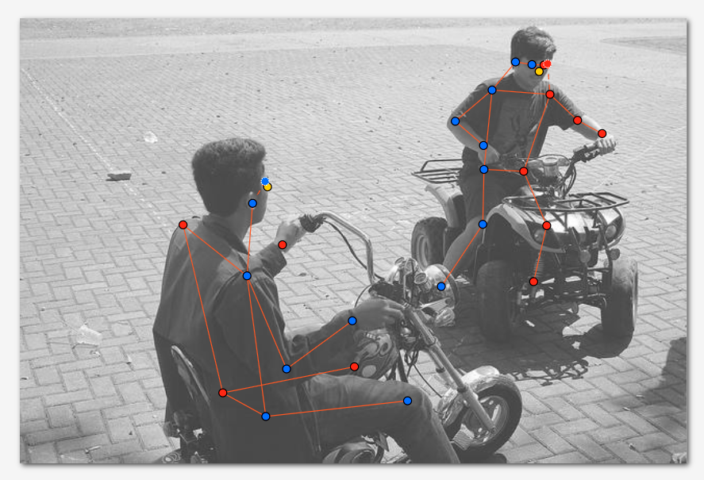
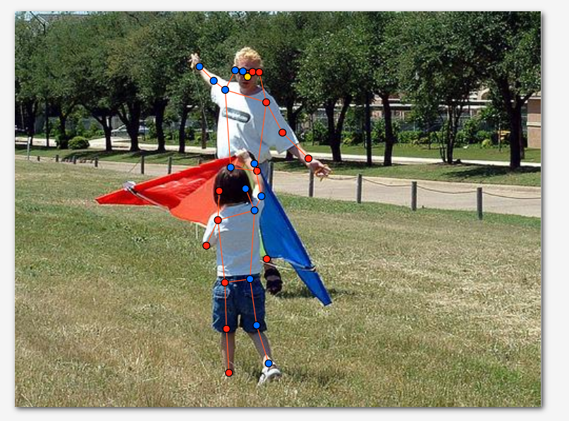
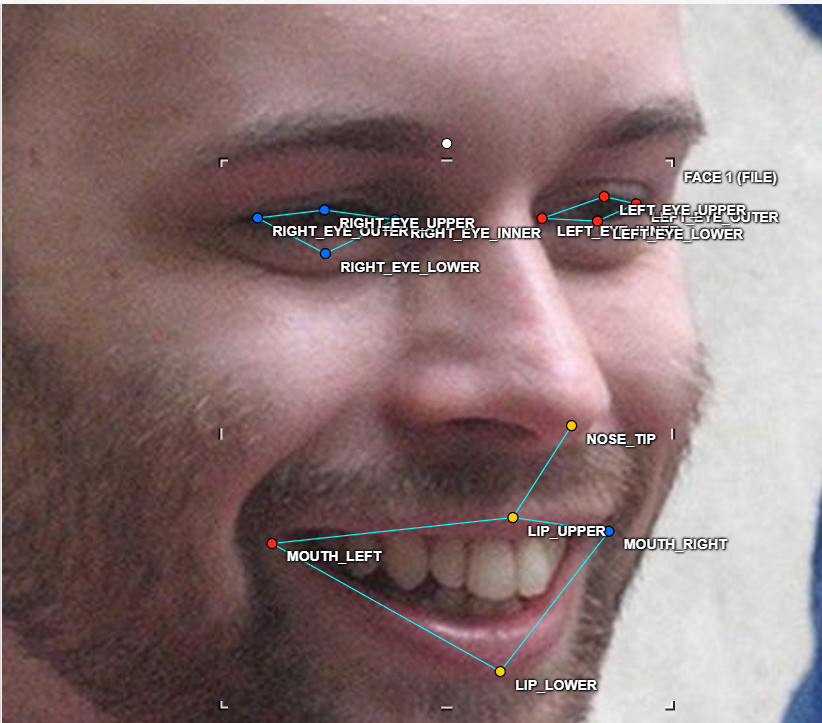
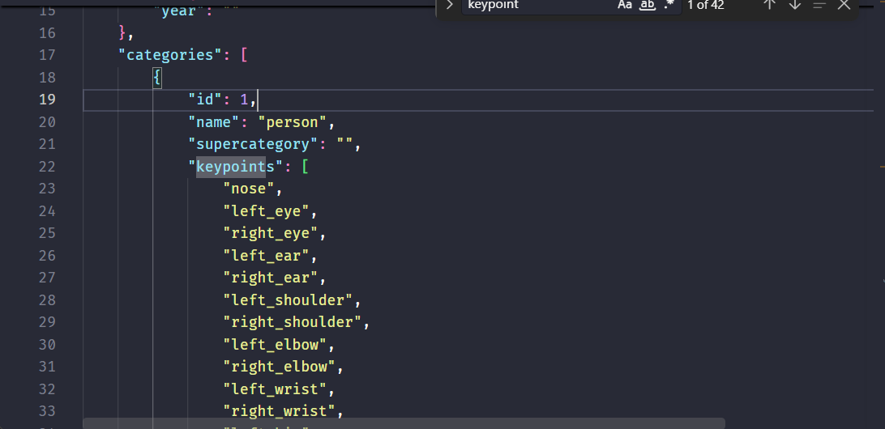

# Báo cáo cá nhân — TruongDuyAnh-2A202603027

Dữ liệu: 12 ảnh người COCO val2017 (Lin et al., 2014) và 8 ảnh chân dung Wikimedia Commons, chỉ dùng trong lớp.

## 0. Thông tin học viên

- Họ tên: TRUONG DUY ANH
- MSSV: 2A202603027
- Email: 
- Link repository:
- Phiên bản CVAT (Help → About): 2.82.1
- Máy: hệ điều hành WINDOW 11 · RAM 16 GB · chạy CVAT chế độ đầy đủ 
- Bộ ảnh (`src/exports/assignment.json` do `lab.py setup` tạo): có
- Giờ bắt đầu: 16:57 
- Giờ kết thúc: 19:30

## 1. Kiểm tra label (CP0)

| Label | Kiểu | Số điểm | Tên điểm đúng bảng của lab? | Đúng thứ tự? | Số cạnh |
|---|---|---:|---|---|---:|
| `person` | skeleton | 17 | Có | Có | 19 |
| `face` | skeleton | 13 | Có | Có | 13 |

Mẫu `person` dựng theo người quay mặt về camera (các điểm `left_*` nằm bên phải khung mẫu)? Có / Không

Cách đổi cờ `occluded` / `outside` cho **một điểm** trên phiên bản CVAT này (một câu):

...

## 2. Số lượng đã gán và thời gian (CP1, CP2)

| Nhóm ảnh | Số ảnh | Số skeleton đã gán | Số người dưới 60 px (không gán) | Số poster / gương / màn hình bỏ qua | Thời gian (phút) |
|---|---:|---:|---:|---:|---:|
| `easy` | 5 | 5 | | | |
| `occluded` | 3 | 6 | | | |
| `back` | 2 | 4 | | | |
| `small` | 1 | 2 | | | |
| `crowd` | 1 | 3 | | | |
| `faces` | 8 | 8 | — | | |

- Số ảnh người đã xong ở mốc phút 105: 9 / 10
- Thời gian thực tế (phút): CP1 25' · CP2 40' · CP3 40'
- Ảnh tốn thời gian nhất là ảnh nào, vì sao?

...

## 3. Bảng ca khó (CP1, CP2)

Mỗi điểm bạn phân vân một dòng, nhất là phân vân giữa `v = 1` và `v = 0`, hoặc không chắc hướng người.

| Ảnh | Người / mặt | Điểm | Cờ đã chọn | Phân vân giữa | Lý do chọn |
|---|---|---|---:|---|---|
| 000000522889 (crowd) | người 1 (id 18) | nose, 2 mắt, 2 tai, right_shoulder, right_elbow, 2 cổ tay | 1 | `v = 1` / `v = 0` | Bị người phía trước che và sát mép trên ảnh, nhưng vẫn suy được vị trí từ dáng đầu và vai nên chọn `v = 1` |
| 000000253584 (small) | người 1 (id 14) | nose, 2 mắt, left_ear, left_elbow, left_wrist | 1 | `v = 1` / `v = 0` | Người chỉ cao khoảng 60 px, mặt và tay quá mờ nhưng vẫn ước được vị trí nên để `v = 1` |
| 000000023424 (back) | người 2 (id 2) | nose, left_eye, right_eye | 0 | `v = 0` / `v = 1` | Người quay lưng, mặt hoàn toàn nằm phía sau đầu, không ước được vị trí chính xác nên chọn `v = 0` |
| 000000023424 (back) | người 2 (id 2) | left_wrist, right_wrist | 1 | `v = 1` / `v = 2` | Tay bị thân và túi xách che một phần, vẫn đoán được vị trí nên chọn `v = 1` |
| 000000122199 (occluded) | người 1 (id 8) | left_shoulder | 0 | `v = 0` / `v = 1` | Vai trái nằm ngoài mép phải ảnh, đánh dấu `outside` |
| 000000177338 (occluded) | người 2 (id 12) | left_ankle, right_ankle | 0 | `v = 0` / `v = 1` | Chân bị khung xe và mép dưới ảnh che hết, không đoán được vị trí nên chọn `v = 0` |
| 000000043500 (back) | người 2 (id 4) | left_ankle, right_ankle | 1 | `v = 1` / `v = 0` | Chân bị thang che, nhưng theo dáng đứng vẫn ước được vị trí nên chọn `v = 1` |
| 000000445187 (easy) | người 1 (id 17) | right_elbow, right_wrist | 0 | `v = 0` / `v = 1` | Tay phải khuất hẳn sau thân, không thấy hướng tay nên chọn `v = 0` |

## 4. Bảng tự review (CP3)

Đi từ ảnh cuối về ảnh đầu. 5 ảnh người (ít nhất 2 ảnh `back` hoặc `crowd`) và 3 ảnh mặt. Ít nhất 8 dòng, kể cả dòng `ok`. Ghi lỗi trước, sửa sau.

Mã lỗi dùng đúng một trong: `lr_swap`, `vis_flag`, `position`, `missing`, `extra`, `ok`.

| Ảnh | Người / mặt | Điểm | Mã lỗi | Ghi chú | Đã sửa? |
|---|---|---|---|---|---|
| 000000522889 (crowd) | 3 người (id 18, 19, 20) | tai, vai | ok | Kiểm vai trái/phải theo hướng mặt, cả 3 người đều đúng | — |
| 000000253584 (small) | người 1 (id 14) | toàn bộ | vis_flag | Bbox cao đúng 60 px, sát ngưỡng; các điểm mặt đang để `v = 1`, nhưng có thể chuyển `v = 0` vì gần như không nhìn thấy | Giữ `v = 1` |
| 000000177338 (occluded) | người 2 (id 12) | left_eye, left_ear | vis_flag | Người quay lưng, nghiêng sang phải: tai trái có thể là `v = 1` thay vì `v = 0` | Cần kiểm lại |
| 000000122199 (occluded) | người 2 (id 9) | left_shoulder ↔ right_shoulder, left_hip ↔ right_hip | lr_swap | Mặt quay về camera nhưng `left_shoulder` đang nằm bên trái ảnh, cùng phía với tay phải cầm gậy: nghi đổi trái/phải | Cần kiểm lại trên CVAT |
| 000000043500 (back) | người 1 (id 3) | vai, hông | ok | Quay lưng, `left_*` nằm bên trái ảnh, đúng | — |
| 000000023424 (back) | người 1, 2 (id 1, 2) | vai, hông | ok | Quay lưng, `left_*` nằm bên trái ảnh, đúng; mặt để `v = 0` | — |
| face_575921 | mặt 1 | 13 điểm | ok | Đủ 13 điểm, mắt trái/phải theo người trong ảnh | — |
| face_559185 | mặt 1 | 13 điểm | ok | Đủ 13 điểm | — |
| face_359139 | mặt 1 | 13 điểm | ok | Đủ 13 điểm | — |

Tổng hợp số lỗi theo mã:

| `lr_swap` | `vis_flag` | `position` | `missing` | `extra` | `ok` |
|---:|---:|---:|---:|---:|---:|
| 1 | 2 | 0 | 0 | 0 | 6 |

Điểm còn phân vân giữa `v = 1` và `v = 0` (ghi cả hai lựa chọn và lý do chọn):

- 000000253584, người 1 (id 14), các điểm mặt: chọn `v = 1` vì vẫn ước được vị trí theo đầu; nếu chọn `v = 0` thì vì người quá nhỏ (60 px), mặt không rõ.
- 000000177338, người 2 (id 12), left_ear: đang để `v = 0` vì đầu quay đi; có thể `v = 1` vì vị trí tai vẫn suy được từ hình đầu.

## 5. Kiểm file xuất và kết quả tự kiểm (CP4)

Tự kiểm tay trong file JSON:

| File | Người / mặt kiểm (ảnh, thứ tự) | Số phần tử `keypoints` | Điểm `outside` ra `v = 0`, `occluded` ra `v = 1`? | `num_keypoints` khớp? |
|---|---|---:|---|---|
| `TruongDuyAnh_persons.zip` | 000000522889, người 1 (id 18) | 51 | Có (0 điểm v=0, 9 điểm v=1) | Có (17) |
| `TruongDuyAnh_persons.zip` | 000000177338, người 2 (id 12) | 51 | Có (5 điểm v=0, 1 điểm v=1) | Có (12) |
| `TruongDuyAnh_faces.zip` | face_137371, mặt 1 (id 1) | 39 | Có (không có điểm v=0 / v=1) | Có (13) |

Sau khi xuất, CVAT ghi `occluded` thành `v = 1` và `outside` thành `v = 0`. Tọa độ của điểm `outside` trong file là `0, 0` hay tọa độ cũ? Tọa độ cũ (ví dụ 000000177338 id 12: điểm v=0 vẫn ở (228.07, 153.51))

Hai job đã chuyển sang completed trên CVAT? Có / Không

Dán phần **TÓM TẮT** in ra từ `src/check_submission.py`:

```text
----- TÓM TẮT (dán vào báo cáo mục 5) -----
- File person: TruongDuyAnh_persons.zip
  Số ảnh: 12 · số skeleton `person`: 20 · mỗi annotation 51 số
  Skeleton theo ảnh: 000000023424=2, 000000043500=2, 000000091637=2, 000000103970=1, 000000122199=2, 000000137767=1, 000000177338=2, 000000241837=1, 000000253584=2, 000000294379=1, 000000445187=1, 000000522889=3
  Cờ v: v=2 274 (81%) · v=1 38 (11%) · v=0 28 (8%)
  num_keypoints trung bình: 15.6
- File face: TruongDuyAnh_faces.zip
  Số ảnh: 8 · số skeleton `face`: 8 · mỗi annotation 39 số
  Skeleton theo ảnh: face_137371=1, face_196742=1, face_219250=1, face_359139=1, face_38721=1, face_436791=1, face_559185=1, face_575921=1
  Cờ v: v=2 104 (100%) · v=1 0 (0%) · v=0 0 (0%)
  num_keypoints trung bình: 13.0
- Ghi chú: 28 điểm v = 0 vẫn mang tọa độ cũ (CVAT 2.x xuất như vậy; chuẩn COCO ghi 0, 0). Không phải lỗi: điểm v = 0 bị bỏ qua khi huấn luyện và khi chấm.
- Số [LỖI]: 0 · số [CẢNH BÁO]: 9
Kết quả: ĐẠT (đọc lại từng cảnh báo ở trên)
```

Các `[CẢNH BÁO]` còn giữ nguyên và lý do:

...

## 6. Ảnh chụp màn hình

1. Label `person` trong label constructor (đủ 17 điểm có tên):

   

2. Một người quay lưng đã gán, cờ đã đặt:

   

3. Một khuôn mặt đã gán 13 điểm, phóng to vùng mắt:

   

4. Một đoạn JSON xuất của một người:

   

Nguồn ảnh: COCO val2017 / Wikimedia Commons.

## 7. Tự đánh giá

1. Lỗi bạn mắc nhiều nhất hôm nay, và cách bạn sẽ tránh ở dự án thật:

   Lỗi nhiều nhất là xác định trái/phải với người quay lưng hoặc xoay người (mặt nhìn camera nhưng thân quay ngang, như 000000122199), và chọn cờ `v = 1` hay `v = 0` cho điểm bị che. Ở dự án thật, trước khi gán mỗi người mình sẽ xác định hướng người trước (mặt hay lưng về camera), gán vai và hông trước để chốt trái/phải, rồi mới gán các điểm còn lại. Sau mỗi ảnh, bật hiển thị tên điểm để kiểm lại cặp trái/phải.

2. Một quy tắc bạn đề xuất thêm vào guideline (kèm ảnh ví dụ nếu có):

   Với người xoay thân (mặt và thân quay khác hướng), trái/phải của vai và hông xác định theo hướng **thân**, không theo hướng mặt; điểm mặt xác định theo hướng mặt. Ví dụ: 000000122199, người cầm gậy trượt tuyết. Thêm quy tắc người có bbox cao đúng khoảng 60 px thì gán và để các điểm mặt `v = 1` nếu còn đoán được vị trí đầu (ví dụ 000000253584).

3. Nhãn của bạn đi vào model ở đâu? Chọn một lỗi bạn đã sửa và nói nó sẽ làm model học sai thế nào (heatmap, trọng số trong loss, hay bước lật ảnh):

   Mỗi điểm `(x, y, v)` được biến thành một heatmap Gaussian đặt tại `(x, y)`; `v` quyết định trọng số trong loss (`v = 0` thì trọng số 0, không học). Với lỗi `lr_swap` ở 000000122199, heatmap kênh `left_shoulder` sẽ đặt lên vai phải thật, nên model học rằng "vai trái" là vai ở phía tay cầm gậy. Khi augmentation lật ảnh, code dùng `flip_pairs` để đổi kênh left/right; nhãn đã sai sẵn nên sau khi lật vẫn sai, và hai phiên bản ảnh dạy model hai điều mâu thuẫn. Kết quả là model hay đổi trái/phải ở người xoay thân hoặc quay lưng.

## 8. Khó khăn và lỗi kỹ thuật

...

## Bonus (nếu làm)

### B1 — 3 ảnh người khó thêm

| Ảnh | Số skeleton | Số người dưới 60 px | Ca khó nhất |
|---|---:|---:|---|
| | | | |
| | | | |
| | | | |

Kết quả `src/check_submission.py` cho `HoVaTen_bonus_persons.zip`:

```text
(dán ở đây)
```

### B2 — 5 ảnh khuôn mặt đen trắng / hồng ngoại

Ảnh không màu khó hơn ở điểm nào? Kính râm trên ảnh hồng ngoại có còn là `v = 1` không?

...

### B3 — Model so với nhãn của tôi (không tính điểm)

- Demo đã dùng:
- Ảnh đã thử:

1. Model có trả điểm cho khớp bị che, hay khớp ngoài ảnh không? Confidence ở các điểm đó thế nào?

   ...

2. Với người quay lưng, model có đổi trái/phải không?

   ...

3. Bộ điểm của model có giống 17 điểm COCO không?

   ...

## 9. Tài liệu tham khảo và công cụ AI đã dùng

- Lin et al., 2014, *Microsoft COCO: Common Objects in Context* (định dạng COCO Keypoints).

